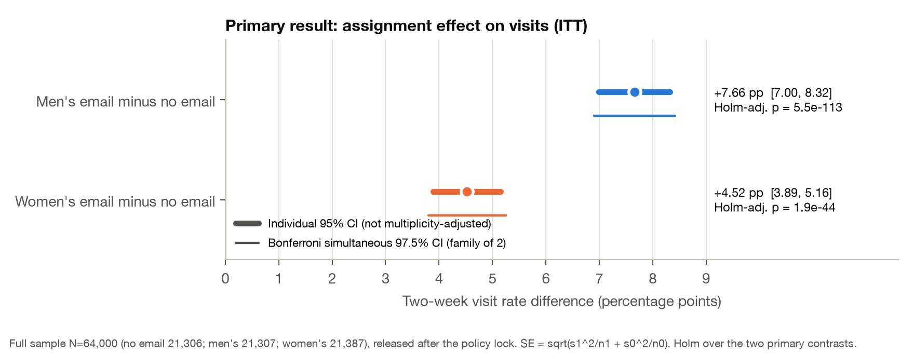
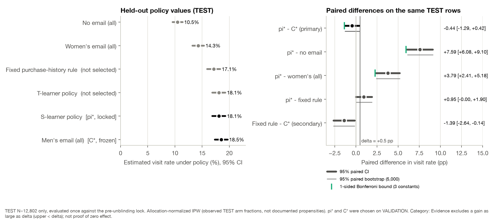

# CampaignLab

Source repository: [CampaignLab](https://github.com/meetsutariya4448/CampaignLab). See [GitHub publication scope](docs/github_publication.md) for included assets and reproduction boundaries.

**Which email campaign should a retailer send, and does a learned targeting policy beat simply sending the best campaign to everyone?** A reproducible retrospective analysis of the publisher-described randomized Hillstrom (2008) email experiment.

> **Bottom line:** Send the men's email to everyone (the simple constant policy). The locked targeting policy did not beat it on held-out data; personalization is not justified by this evidence.

> **Evidence boundary:** historical 2008 data, two-week outcomes, publisher-described (not independently verified) randomization, unknown customer identity, sparse purchases, and hypothetical economics. No raw data are included in this repository.

## Results

| Type | Result |
|---|---|
| Estimated historical effect (primary, N = 64,000) | Men's email vs no email: **+7.66 pp** visit rate (95% CI 7.00 to 8.32) |
| Estimated historical effect (primary, N = 64,000) | Women's email vs no email: **+4.52 pp** (95% CI 3.89 to 5.16); Holm-adjusted p ≤ 1.9e-44 |
| Held-out policy evaluation (TEST, N = 12,802, locked) | Interacted logistic s-learner policy vs men's email to everyone: **-0.44 pp** (95% paired CI -1.29 to 0.42) — evidence excludes a gain ≥ 0.5 pp; superiority over the constant family not established |
| Exploratory | Purchase history strongly modifies effect sizes, but the best action barely changes: the men's email had the larger estimated effect in every historical-purchase profile except womens only (+0.34 pp), where the women's email led by that exploratory, uncorrected margin. |
| Hypothetical scenarios | Assumed visit values/costs and margins (Panels A and B kept separate); not profit |
| Synthetic tests | Known-truth simulations check estimator coverage and the select-then-evaluate pipeline |

Read the [executive memo](reports/executive_memo.md) and the full [technical report](reports/technical_report.md).




## How the study was protected against self-deception

1. **Frozen plan first** — [`docs/analysis_plan.md`](docs/analysis_plan.md) and [`config/analysis.yaml`](config/analysis.yaml) were committed before any arm-by-outcome analysis (prior schema/global-count inspection is disclosed).
2. **Deterministic split** — SHA-256 of source-ordinal row IDs within arm → TRAIN 38,399 / VALIDATION 12,799 / TEST 12,802; no outcome in the key.
3. **TRAIN fits, VALIDATION selects, TEST evaluates once** — a lock manifest (data, split, code, config, environment, model and 66 action-vector checksums) is verified before TEST outcomes can be loaded; the full-sample analysis is released only afterwards. Access is enforced in code and logged.
4. **Strong baselines** — no-send, men's-for-all, women's-for-all, a frozen purchase-history rule, and feasible hash quotas under capacity limits; paired uncertainty on the same rows; simultaneous bounds before any claim against the strongest constant.

## Data and rights

Source: Kevin Hillstrom, [*MineThatData E-Mail Analytics and Data Mining Challenge*](https://blog.minethatdata.com/2008/03/minethatdata-e-mail-analytics-and-data.html) (2008). The publisher invites analysis but no redistribution license was found, so **this repository contains no raw or row-level data, split membership, per-row predictions, databases or serialized models**. The pipeline downloads the original file and verifies SHA-256 `0e5893329d8b93cefecc571777672028290ab69865718020c78c7284f291aece`. The MIT license covers the code only — see [`docs/rights_and_assumptions.md`](docs/rights_and_assumptions.md).

## Reproduce

```bash
python3 -m venv .venv            # tested with CPython 3.14.3
.venv/bin/pip install -r requirements.lock
.venv/bin/pip install --no-deps -e .
.venv/bin/python -m campaignlab.run all        # acquire → validate → develop → fit → select → lock → evaluate → release → report
.venv/bin/python -m campaignlab.run simulate   # synthetic known-truth validation
.venv/bin/python -m pytest                     # test suite (private-data tests skip if the CSV is absent)
```

Details, expected hashes and the recorded clean rerun: [`docs/reproduction.md`](docs/reproduction.md).

## Repository map

| Path | Contents |
|---|---|
| `config/analysis.yaml` | Frozen estimands, methods, grids, seeds |
| `sql/` | DuckDB validation, development-only and final summary SQL |
| `src/campaignlab/` | `data`, `inference`, `models`, `policy`, `evaluation`, `governance`, `reporting`, `simulation`, `run` |
| `tests/` | Contract, split, estimator, leakage, policy, end-to-end access-control and simulation tests |
| `reports/` | Memo, technical report, figures (PNG/SVG) and aggregate tables |
| `docs/` | Analysis plan, data dictionary, rights, implementation log, reproduction, case study, evidence ledger, interview prep |

Not claimed: a live experiment, deployment, modern-ecommerce generalization, observed profit, or methodological novelty.
