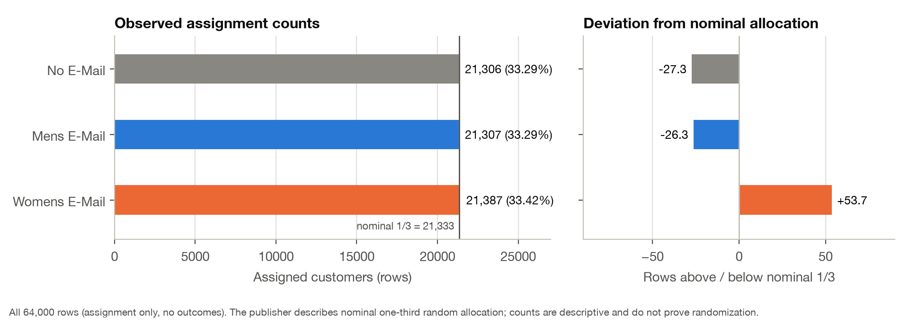
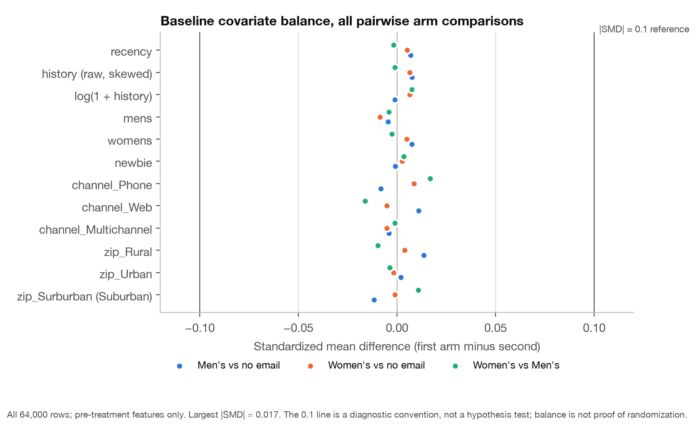
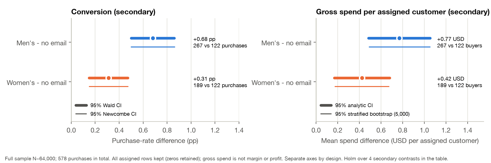
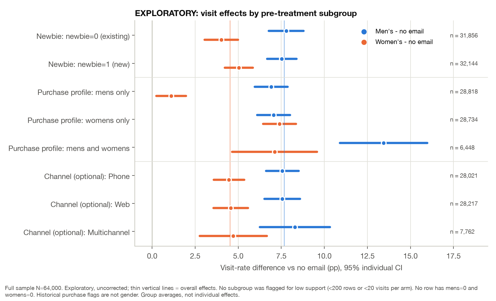
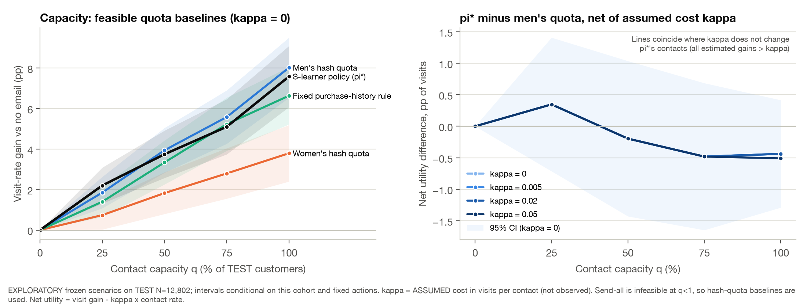
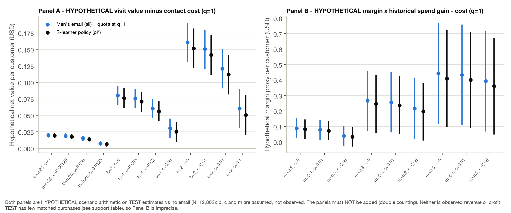

# CampaignLab technical report

*Retrospective analysis of a publisher-described randomized email experiment (Hillstrom, 2008). Generated from the reviewed aggregate tables in `reports/tables/`; every number below is read from those files. Plan: SAP v1.0 (`docs/analysis_plan.md`).*

**Result taxonomy used throughout:** *observed facts* (counts in the file) · *estimated historical effects* (ITT contrasts with uncertainty) · *exploratory results* (subgroups, capacity curves; uncorrected) · *model predictions* (response probabilities, not individual effects) · *synthetic tests* (simulated data only) · *hypothetical scenarios* (assumed costs, values, margins).

## 1. Summary

- **Primary (estimated historical effects, N = 64,000):** men's email − no email **+7.66 pp** (95% CI 7.00 to 8.32; Bonferroni 97.5% 6.90 to 8.42); women's email − no email **+4.52 pp** (95% CI 3.89 to 5.16; Bonferroni 3.80 to 5.25). Holm-adjusted p = 5.5e-113 and 1.9e-44.
- **Policy (TEST, N = 12,802, locked):** π* = interacted logistic S-learner policy vs C* = men's email to everyone: **-0.44 pp** (95% paired CI -1.29 to 0.42). Decision category: *Evidence excludes a gain as large as delta (upper < delta); not proof of zero effect*. Sensitivity categories: analytic_95 → excludes_margin, bootstrap_95 → excludes_margin, doubly_robust → excludes_margin, nominal_ht → excludes_margin, profile_clustered → excludes_margin (fragile: False). Strongest-constant-family superiority: **not established**.
- **Recommendation:** Send the men's email to everyone (the simple constant policy). The locked targeting policy did not beat it on held-out data; personalization is not justified by this evidence. Use the simple constant policy (men's email to everyone) if a decision must be made from this historical evidence, and validate it (and its real costs) in a contemporary randomized test before relying on it.

## 2. Question, estimands and decision

The hypothetical stakeholder (an ecommerce growth lead) must choose which campaign to send, whether personalization warrants further investment, and how a contact budget changes the choice. Estimands (SAP §1): τ(a, visit) = E[Y(a) − Y(0)] for a ∈ {M, W} (primary, ITT), the same contrasts for purchase and gross spend per assigned customer (secondary), and the held-out policy value difference Δ(π*, C*) on TEST. The unit is a source row assumed to be a distinct customer.

## 3. Data, provenance and quality (observed facts)

Original publisher CSV, **3,964,977 bytes**, SHA-256 `0e5893329d8b93cefecc571777672028290ab69865718020c78c7284f291aece`, 64,000 rows × 12 columns; all hard contract checks passed in both Python and SQL. 9,394 visits, 578 purchases, 578 positive-spend rows. 1,072 groups of identical full rows (6,562 excess rows) and 56,209 distinct pre-treatment profiles (7,791 excess) are **retained** — equal values do not identify the same person. 5 rows sit on rounded `history_segment` boundaries (100/200/500) and are kept as soft warnings. `Surburban` is preserved as spelled in the source. No rows were excluded. Raw data are not redistributed (rights unresolved).

## 4. Frozen plan and information flow

The SAP and configuration were committed (git `60d32e3`) before any arm-by-outcome analysis; schema/global counts had been seen earlier and this is disclosed (not a blinded preregistration). The deterministic arm-stratified split gave TRAIN 38,399 / VALIDATION 12,799 / TEST 12,802. Development inference used TRAIN+VALIDATION only; TRAIN fitted models; VALIDATION selected π* and C*; a lock manifest (dataset, split, code, config, environment, model, selection and 66 TEST action checksums) was written and committed before TEST outcomes were first read; the full-sample analysis was released only after the evaluation record existed. Code enforces these scopes and logs each outcome access.

## 5. Experimental inference (full sample, released after the lock)

*Figure 1. Observed assignment counts (all 64,000 rows; assignment only). Deviations from the nominal one-third are No E-Mail -27.3 rows, Mens E-Mail -26.3 rows, Womens E-Mail +53.7 rows. Counts are descriptive; no design-based SRM test is invented because the allocation mechanism is not documented.*

*Figure 2. Standardized mean differences for all pre-treatment features and all three arm pairs (N = 64,000). Largest |SMD| = 0.017, far below the 0.1 diagnostic reference.*

**Arm summaries (observed, N = 64,000):**

| arm | n | visit_events | visit rate | conversion_events | purchase rate | mean spend (USD) |
|---|---|---|---|---|---|---|
| No E-Mail | 21306 | 2262 | 10.62% | 122 | 0.57% | 0.653 |
| Mens E-Mail | 21307 | 3894 | 18.28% | 267 | 1.25% | 1.423 |
| Womens E-Mail | 21387 | 3238 | 15.14% | 189 | 0.88% | 1.077 |

**Effect table (primary family: Holm over 2; secondary family: Holm over 4; W − M exploratory):**

| family | outcome | contrast | n treat / control | events treat / control | estimate | SE | 95% CI (individual) | simultaneous 97.5% CI | raw p | Holm p (family) |
|---|---|---|---|---|---|---|---|---|---|---|
| primary | visit | M - 0 | 21307 / 21306 | 3894 / 2262 | +7.66 pp | 0.339 pp | 7.00 to 8.32 | 6.90 to 8.42 | 2.7e-113 | 5.5e-113 |
| primary | visit | W - 0 | 21387 / 21306 | 3238 / 2262 | +4.52 pp | 0.323 pp | 3.89 to 5.16 | 3.80 to 5.25 | 1.9e-44 | 1.9e-44 |
| secondary | conversion | M - 0 | 21307 / 21306 | 267 / 122 | +0.68 pp | 0.092 pp | 0.50 to 0.86 | — | 1.5e-13 | 5.9e-13 |
| secondary | conversion | W - 0 | 21387 / 21306 | 189 / 122 | +0.31 pp | 0.082 pp | 0.15 to 0.47 | — | 1.6e-04 | 3.1e-04 |
| secondary | spend | M - 0 | 21307 / 21306 | 267 / 122 | +0.770 USD | 0.145 | 0.485 to 1.055 | — | 1.2e-07 | 3.5e-07 |
| secondary | spend | W - 0 | 21387 / 21306 | 189 / 122 | +0.424 USD | 0.130 | 0.169 to 0.680 | — | 0.001 | 0.001 |
| exploratory | visit | W - M | 21387 / 21307 | 3238 / 3894 | -3.14 pp | 0.361 pp | -3.84 to -2.43 | — | 3.6e-18 | — |
| exploratory | conversion | W - M | 21387 / 21307 | 189 / 267 | -0.37 pp | 0.100 pp | -0.56 to -0.17 | — | 2.1e-04 | — |
| exploratory | spend | W - M | 21387 / 21307 | 189 / 267 | -0.345 USD | 0.160 | -0.658 to -0.033 | — | 0.030 | — |

Individual 95% intervals are ordinary (not multiplicity-adjusted) intervals; the simultaneous 97.5% Bonferroni intervals apply to the two primary contrasts only. Holm-adjusted p-values do not convert ordinary intervals into simultaneous ones.

*Figure 3. Primary ITT visit effects (N = 64,000; no email 21,306, men's 21,307, women's 21,387). Thick: individual 95% CI; thin: Bonferroni 97.5% simultaneous CI.*

*Figure 4. Secondary outcomes on separate axes. Conversion: Wald and Newcombe 95% intervals; spend per assigned customer (zeros retained): analytic and 5,000-replicate stratified bootstrap 95% intervals. Purchases are sparse (578 overall).*

**Sensitivity results (none replaces the primary estimator):**

- *Covariate adjustment* — fixed centered, fully interacted OLS (Lin-style; rank 30, condition number 66.9), HC2 with HC3 sensitivity:

| outcome | contrast | covariance | unadjusted | adjusted | SE ratio adj/unadj |
|---|---|---|---|---|---|
| visit | M - 0 | HC2 | +7.66 pp | +7.61 pp | 0.984 |
| visit | W - 0 | HC2 | +4.52 pp | +4.55 pp | 0.987 |
| visit | M - 0 | HC3 | +7.66 pp | +7.61 pp | 0.985 |
| visit | W - 0 | HC3 | +4.52 pp | +4.55 pp | 0.987 |
| conversion | M - 0 | HC2 | +0.68 pp | +0.68 pp | 0.998 |
| conversion | W - 0 | HC2 | +0.31 pp | +0.31 pp | 1.000 |
| conversion | M - 0 | HC3 | +0.68 pp | +0.68 pp | 0.998 |
| conversion | W - 0 | HC3 | +0.31 pp | +0.31 pp | 1.001 |
| spend | M - 0 | HC2 | +0.770 | +0.768 | 0.997 |
| spend | W - 0 | HC2 | +0.424 | +0.428 | 1.001 |
| spend | M - 0 | HC3 | +0.770 | +0.768 | 0.998 |
| spend | W - 0 | HC3 | +0.424 | +0.428 | 1.001 |

- *Joint arm × covariate interaction test (visit, HC2):* χ² = 147.8 on 18 df, p = 2.0e-22 (exploratory).
- *Profile-clustered SEs* (hypothetical dependence among identical pre-treatment profiles; SE ratio clustered / row-independent): visit M - 0: 0.996, visit W - 0: 0.995, conversion M - 0: 0.998, conversion W - 0: 1.003, spend M - 0: 1.001, spend W - 0: 1.016.
- *Conversion, Newcombe 95%:* M - 0: 0.50 to 0.86 pp, W - 0: 0.15 to 0.47 pp.
- *Spend bootstrap (5,000, stratified within arm):* M - 0: 0.492 to 1.053 (second independent 5,000: 0.486 to 1.058), W - 0: 0.176 to 0.674 (second independent 5,000: 0.164 to 0.693).
- *Spend tails (TRAIN-frozen thresholds; winsorized means are different estimands):*

| version | contrast | est | ci | rows_capped |
|---|---|---|---|---|
| raw (primary) | M - 0 | +0.770 | 0.485 to 1.055 | 0 |
| raw (primary) | W - 0 | +0.424 | 0.169 to 0.680 | 0 |
| winsorized at TRAIN 99.5th pct, all rows | M - 0 | +0.323 | 0.229 to 0.417 | 342 |
| winsorized at TRAIN 99.5th pct, all rows | W - 0 | +0.156 | 0.070 to 0.242 | 342 |
| winsorized at TRAIN 99.5th pct, positive spend | M - 0 | +0.770 | 0.485 to 1.055 | 0 |
| winsorized at TRAIN 99.5th pct, positive spend | W - 0 | +0.424 | 0.169 to 0.680 | 0 |

  The positive-spend threshold equals the observed maximum ($499), so it caps nothing.
- *Randomization inference* (assumed complete randomization conditional on arm counts; sharp null of no unit-level effect; 9,999 draws): M - 0: p = 0.0001 (0 draws as extreme), W - 0: p = 0.0001 (0 draws as extreme) — the smallest attainable p at this draw count.
- *Development (provisional) vs full sample:* visit M - 0: +0.0757 → +0.0766, visit W - 0: +0.0471 → +0.0452.

## 6. Exploratory heterogeneity

*Figure 5. Exploratory, uncorrected subgroup visit effects (N = 64,000); no subgroup was flagged for low support. Group averages under randomization, not individual effects; purchase flags are not gender.*

| grouping | subgroup | contrast | n_treat | n_control | visits_treat | visits_control | est | ci | support_flag |
|---|---|---|---|---|---|---|---|---|---|
| newbie | newbie=0 (existing) | M - 0 | 10621 | 10611 | 2247 | 1419 | +7.78 | 6.77 to 8.79 | False |
| newbie | newbie=0 (existing) | W - 0 | 10624 | 10611 | 1847 | 1419 | +4.01 | 3.04 to 4.98 | False |
| newbie | newbie=1 (new) | M - 0 | 10686 | 10695 | 1647 | 843 | +7.53 | 6.68 to 8.38 | False |
| newbie | newbie=1 (new) | W - 0 | 10763 | 10695 | 1391 | 843 | +5.04 | 4.23 to 5.86 | False |
| purchase_profile | mens and womens | M - 0 | 2181 | 2149 | 687 | 388 | +13.44 | 10.91 to 15.98 | False |
| purchase_profile | mens and womens | W - 0 | 2118 | 2149 | 533 | 388 | +7.11 | 4.65 to 9.57 | False |
| purchase_profile | mens only | M - 0 | 9558 | 9638 | 1615 | 962 | +6.92 | 5.96 to 7.88 | False |
| purchase_profile | mens only | W - 0 | 9622 | 9638 | 1067 | 962 | +1.11 | 0.24 to 1.97 | False |
| purchase_profile | womens only | M - 0 | 9568 | 9519 | 1592 | 912 | +7.06 | 6.11 to 8.01 | False |
| purchase_profile | womens only | W - 0 | 9647 | 9519 | 1638 | 912 | +7.40 | 6.44 to 8.35 | False |
| channel | Multichannel | M - 0 | 2577 | 2606 | 545 | 335 | +8.29 | 6.26 to 10.33 | False |
| channel | Multichannel | W - 0 | 2579 | 2606 | 453 | 335 | +4.71 | 2.76 to 6.66 | False |
| channel | Phone | M - 0 | 9240 | 9327 | 1504 | 813 | +7.56 | 6.61 to 8.51 | False |
| channel | Phone | W - 0 | 9454 | 9327 | 1246 | 813 | +4.46 | 3.57 to 5.35 | False |
| channel | Web | M - 0 | 9490 | 9373 | 1845 | 1114 | +7.56 | 6.53 to 8.59 | False |
| channel | Web | W - 0 | 9354 | 9373 | 1539 | 1114 | +4.57 | 3.57 to 5.56 | False |

Heterogeneity (equal-effect) Wald tests: newbie M - 0: Q = 0.14 (df 1), p = 0.708, newbie W - 0: Q = 2.54 (df 1), p = 0.111, purchase_profile M - 0: Q = 23.24 (df 2), p = 9.0e-06, purchase_profile W - 0: Q = 97.34 (df 2), p = 7.3e-22, channel M - 0: Q = 0.45 (df 2), p = 0.799, channel W - 0: Q = 0.06 (df 2), p = 0.970. Purchase history modifies effect *sizes* strongly (e.g. women's email − no email is +1.11 pp for men's-only buyers vs +7.40 pp for women's-only buyers), but the *best action* rarely changes: the men's email had the larger estimated effect in every historical-purchase profile except womens only (+0.34 pp), where the women's email led by that exploratory, uncorrected margin. That is why large effect heterogeneity produced little room for targeting gains.

## 7. Targeting models (TRAIN fits, VALIDATION selects)

Basis: recency, log(1+history), mens, womens, newbie, Web/Multichannel and Urban/Surburban indicators (TRAIN-standardized continuous columns; `history_segment` excluded). S-learner: one L2 logistic model with arm indicators and all arm × basis interactions. T-learner: three arm-specific L2 logistic models; support gate passed and it was included. Three-fold arm-stratified CV inside TRAIN, fold-local preprocessing:

| learner | C | mean_logloss | all_converged | selected |
|---|---|---|---|---|
| s_learner | 0.1 | 0.398788 | True | True |
| s_learner | 1.0 | 0.398804 | True | False |
| s_learner | 10.0 | 0.398814 | True | False |
| t_learner | 0.1 | 0.398844 | True | False |
| t_learner | 1.0 | 0.398808 | True | True |
| t_learner | 10.0 | 0.398814 | True | False |

VALIDATION response diagnostics (prediction quality, **not** uplift quality):

| learner | C | logloss | brier | mean_predicted | observed_rate |
|---|---|---|---|---|---|
| s_learner | 0.1 | 0.4038 | 0.1224 | 0.1461064453578456 | 0.1489960153136963 |
| t_learner | 1.0 | 0.4038 | 0.1224 | 0.1461339854116985 | 0.1489960153136963 |

Development-only diagnostics: S-learner, arm-stratified 3-fold CV (selected C): 0.398788; S-learner, profile-grouped 3-fold CV (identical profiles kept together): 0.398691; S-learner with history_segment indicators instead of log(1+history) (encoding diagnostic): 0.398976; Main-effects-only S-learner (instructional ablation): 0.399527; Main-effects-only S-learner VALIDATION action shares at q=1,kappa=0: {'No E-Mail': 0.0, 'Mens E-Mail': 1.0, 'Womens E-Mail': 0.0}. Across 20 development resplits the refitted S-learner minus the best constant ranged -0.73 to +0.84 pp (mean +0.26 pp), signalling a small and unstable targeting gain before the TEST evaluation.

**VALIDATION selection** (allocation-normalized IPW):

| policy | value | contact | diff |
|---|---|---|---|
| const_0 | 10.58% | 0.0% | -7.89 pp |
| const_M | 18.47% | 100.0% | +0.00 pp |
| const_W | 15.64% | 100.0% | -2.83 pp |
| fixed_rule | 17.43% | 89.9% | -1.04 pp |
| s_learner | 18.64% | 100.0% | +0.17 pp |
| t_learner | 18.66% | 100.0% | +0.19 pp |

C* = men's email to everyone (largest constant value). Targeting candidates within one paired SE of the best were eligible and the simplest eligible was chosen:

| candidate | validation_value | gap_to_best | paired_se_vs_best | status | eligible_within_one_se |
|---|---|---|---|---|---|
| fixed_rule | 0.1743013736003095 | 0.0123301326794663 | 0.0050140861224242 | ok | False |
| s_learner | 0.1863976975353287 | 0.000233808744447 | 0.000233808744447 | ok | True |
| t_learner | 0.1866315062797758 | 0.0 | 0.0 | identical_policies | True |

The S-learner and T-learner differ on very few VALIDATION rows; their gap equals exactly one paired SE (a single discordant matched visit), and the frozen inclusive rule selected the simpler S-learner. No code changed after this was observed.

## 8. Held-out policy evaluation (TEST, evaluated once)

*Figure 6. TEST N = 12,802 only. Left: policy values (allocation-normalized IPW with 95% CIs). Right: paired differences on the same rows with 95% paired CIs, paired within-arm bootstrap (5,000) intervals and one-sided Bonferroni bounds for the three-constant family. Observed TEST arm fractions are not documented individual propensities.*

| policy | role | value | ci | HT | DR | contact | M | W |
|---|---|---|---|---|---|---|---|---|
| const_0 | constant | 10.49% | 9.57 to 11.41 | 10.47% | 10.52% | 0.0% | 0.0% | 0.0% |
| const_M | frozen comparator (C*) | 18.51% | 17.35 to 19.68 | 18.49% | 18.40% | 100.0% | 100.0% | 0.0% |
| const_W | constant | 14.28% | 13.23 to 15.33 | 14.32% | 14.35% | 100.0% | 0.0% | 100.0% |
| fixed_rule | targeting candidate, NOT selected (secondary) | 17.13% | 15.93 to 18.32 | 17.13% | 17.16% | 90.0% | 45.3% | 44.8% |
| s_learner | selected targeting policy (pi*) | 18.08% | 16.88 to 19.27 | 18.07% | 17.98% | 100.0% | 70.7% | 29.3% |
| t_learner | targeting candidate, NOT selected (secondary) | 18.08% | 16.88 to 19.27 | 18.07% | 17.96% | 100.0% | 70.6% | 29.4% |

| policy | baseline | role | est | ci | boot | dr | clus | decision_category |
|---|---|---|---|---|---|---|---|---|
| s_learner | const_M | primary: pi* vs frozen C* | -0.44 | -1.29 to 0.42 | -1.28 to 0.41 | -0.42 | 1.005 | excludes_margin |
| s_learner | const_0 | pi* vs constant (family member) | +7.59 | 6.08 to 9.10 | 6.11 to 9.13 | +7.46 | 0.991 | meaningful_gain |
| s_learner | const_W | pi* vs constant (family member) | +3.79 | 2.41 to 5.18 | 2.43 to 5.20 | +3.63 | 0.993 | meaningful_gain |
| s_learner | fixed_rule | pi* vs fixed rule | +0.95 | -0.00 to 1.90 | 0.01 to 1.91 | +0.81 | 0.994 | insufficient |
| fixed_rule | const_M | secondary: non-selected candidate | -1.39 | -2.64 to -0.14 | -2.63 to -0.15 | -1.24 | 0.998 | worse |
| fixed_rule | const_0 | secondary: non-selected candidate | +6.64 | 5.22 to 8.05 | 5.25 to 8.11 | +6.65 | 0.992 | meaningful_gain |
| fixed_rule | const_W | secondary: non-selected candidate | +2.84 | 1.64 to 4.04 | 1.65 to 4.04 | +2.82 | 0.993 | meaningful_gain |
| t_learner | const_M | secondary: non-selected candidate | -0.44 | -1.29 to 0.42 | -1.28 to 0.41 | -0.44 | 1.005 | excludes_margin |
| t_learner | const_0 | secondary: non-selected candidate | +7.59 | 6.08 to 9.10 | 6.11 to 9.13 | +7.45 | 0.991 | meaningful_gain |
| t_learner | const_W | secondary: non-selected candidate | +3.79 | 2.41 to 5.18 | 2.43 to 5.20 | +3.61 | 0.993 | meaningful_gain |
| t_learner | fixed_rule | secondary: non-selected candidate | +0.95 | -0.00 to 1.90 | 0.01 to 1.91 | +0.80 | 0.994 | insufficient |

**Primary comparison:** -0.44 pp (95% CI -1.29 to 0.42; bootstrap -1.28 to 0.41; nominal-1/3 HT -0.42 pp; TRAIN-nuisance DR -0.42 pp (-1.22 to 0.38); profile-cluster SE ratio 1.005). With δ = 0.5 pp: **Evidence excludes a gain as large as delta (upper < delta); not proof of zero effect**.

**Strongest-constant family** (z = 2.128): one-sided lower bounds no email to anyone +5.95 pp, men's email to everyone -1.36 pp, women's email to everyone +2.29 pp → superiority over the constant family is **not established**.

**Support** (only rows whose assigned arm equals the recommended action contribute rewards):

| policy | outcome | arm | n_arm | matched_rows | matched_events | share |
|---|---|---|---|---|---|---|
| const_M | visit | 0 | 4262 | 0 | 0 | 0.000 |
| const_M | visit | M | 4262 | 4262 | 789 | 1.000 |
| const_M | visit | W | 4278 | 0 | 0 | 0.000 |
| const_M | spend (positive-spend events) | 0 | 4262 | 0 | 0 | 0.000 |
| const_M | spend (positive-spend events) | M | 4262 | 4262 | 61 | 1.000 |
| const_M | spend (positive-spend events) | W | 4278 | 0 | 0 | 0.000 |
| s_learner | visit | 0 | 4262 | 0 | 0 | 0.000 |
| s_learner | visit | M | 4262 | 3032 | 600 | 0.711 |
| s_learner | visit | W | 4278 | 1241 | 171 | 0.290 |
| s_learner | spend (positive-spend events) | 0 | 4262 | 0 | 0 | 0.000 |
| s_learner | spend (positive-spend events) | M | 4262 | 3032 | 49 | 0.711 |
| s_learner | spend (positive-spend events) | W | 4278 | 1241 | 11 | 0.290 |

Bootstrap stability: the largest change in a 95% endpoint between 5,000 and 10,000 replicates was 0.047 pp (target ≤ 0.1 pp). The secondary, non-selected candidates are reported for transparency only; they cannot replace π* after TEST.

## 9. Capacity and assumed costs (exploratory frozen scenarios)

*Figure 7. TEST N = 12,802. Left: visit gain vs no email by contact capacity with feasible hash-quota baselines (κ = 0). Right: π* minus the men's quota after subtracting κ × contact rate. Intervals are conditional on this cohort and the fixed actions; no simultaneous coverage across cells is claimed.*

| policy | q | contacts | gain vs no email (pp) | minus men's quota (pp, 95% CI) |
|---|---|---|---|---|
| fixed_rule | 0.0 | 0 | +0.00 | +0.00 (0.00 to 0.00) |
| quota_M | 0.0 | 0 | +0.00 | +0.00 (0.00 to 0.00) |
| quota_W | 0.0 | 0 | +0.00 | +0.00 (0.00 to 0.00) |
| s_learner | 0.0 | 0 | +0.00 | +0.00 (0.00 to 0.00) |
| fixed_rule | 0.25 | 3200 | +1.40 | -0.45 (-1.11 to 0.21) |
| quota_M | 0.25 | 3200 | +1.85 | +0.00 (0.00 to 0.00) |
| quota_W | 0.25 | 3200 | +0.74 | -1.12 (-1.93 to -0.30) |
| s_learner | 0.25 | 3200 | +2.20 | +0.35 (-0.71 to 1.41) |
| fixed_rule | 0.5 | 6401 | +3.34 | -0.60 (-1.56 to 0.36) |
| quota_M | 0.5 | 6401 | +3.94 | +0.00 (0.00 to 0.00) |
| quota_W | 0.5 | 6401 | +1.83 | -2.12 (-3.28 to -0.95) |
| s_learner | 0.5 | 6401 | +3.75 | -0.20 (-1.43 to 1.04) |
| fixed_rule | 0.75 | 9601 | +5.23 | -0.35 (-1.51 to 0.80) |
| quota_M | 0.75 | 9601 | +5.58 | +0.00 (0.00 to 0.00) |
| quota_W | 0.75 | 9601 | +2.80 | -2.79 (-4.18 to -1.39) |
| s_learner | 0.75 | 9601 | +5.10 | -0.48 (-1.65 to 0.68) |
| fixed_rule | 1.0 | 11522 | +6.64 | -1.39 (-2.64 to -0.14) |
| quota_M | 1.0 | 12802 | +8.02 | +0.00 (0.00 to 0.00) |
| quota_W | 1.0 | 12802 | +3.79 | -4.23 (-5.80 to -2.66) |
| s_learner | 1.0 | 12802 | +7.59 | -0.44 (-1.29 to 0.42) |

π* minus men's quota, net utility (pp) for every frozen (q, κ):

| q | kappa=0 | kappa=0.005 | kappa=0.02 | kappa=0.05 |
|---|---|---|---|---|
| 0.0 | +0.00 | +0.00 | +0.00 | +0.00 |
| 0.25 | +0.35 | +0.35 | +0.35 | +0.35 |
| 0.5 | -0.20 | -0.20 | -0.20 | -0.20 |
| 0.75 | -0.48 | -0.48 | -0.48 | -0.48 |
| 1.0 | -0.44 | -0.44 | -0.44 | -0.51 |

**Hypothetical economics (two separate panels; never added; not observed profit).**

*Supplementary figure. Panel A: b × visit gain − c × contact rate with assumed b ∈ {0.25, 1, 2} USD per visit and c = b·κ. Panel B: m × historical gross-spend gain − c × contact rate with assumed margin m ∈ {0.1, 0.3, 0.5} and c ∈ {0, 0.01, 0.05}. q = 1, versus no email.*

Panel A (USD per customer, 95% CI):

| b_value_per_visit | kappa | c_cost_per_contact | quota_M | s_learner |
|---|---|---|---|---|
| 0.25 | 0.0 | 0.0 | 0.0201 (0.0163 to 0.0238) | 0.0190 (0.0152 to 0.0227) |
| 0.25 | 0.005 | 0.00125 | 0.0188 (0.0151 to 0.0225) | 0.0177 (0.0139 to 0.0215) |
| 0.25 | 0.02 | 0.005 | 0.0151 (0.0113 to 0.0188) | 0.0140 (0.0102 to 0.0177) |
| 0.25 | 0.05 | 0.0125 | 0.0076 (0.0038 to 0.0113) | 0.0063 (0.0025 to 0.0101) |
| 1.0 | 0.0 | 0.0 | 0.0802 (0.0654 to 0.0951) | 0.0759 (0.0608 to 0.0910) |
| 1.0 | 0.005 | 0.005 | 0.0752 (0.0604 to 0.0901) | 0.0709 (0.0558 to 0.0860) |
| 1.0 | 0.02 | 0.02 | 0.0602 (0.0454 to 0.0751) | 0.0559 (0.0408 to 0.0710) |
| 1.0 | 0.05 | 0.05 | 0.0302 (0.0154 to 0.0451) | 0.0252 (0.0101 to 0.0402) |
| 2.0 | 0.0 | 0.0 | 0.1605 (0.1308 to 0.1902) | 0.1517 (0.1215 to 0.1820) |
| 2.0 | 0.005 | 0.01 | 0.1505 (0.1208 to 0.1802) | 0.1417 (0.1115 to 0.1720) |
| 2.0 | 0.02 | 0.04 | 0.1205 (0.0908 to 0.1502) | 0.1117 (0.0815 to 0.1420) |
| 2.0 | 0.05 | 0.1 | 0.0605 (0.0308 to 0.0902) | 0.0503 (0.0202 to 0.0804) |

Panel B (USD per customer, 95% CI; matched TEST purchases: 60 for π*, 61 for men's email to everyone, so precision is low):

| margin_m | contact_cost_c | quota_M | s_learner |
|---|---|---|---|
| 0.1 | 0.0 | 0.089 (0.023 to 0.154) | 0.082 (0.020 to 0.144) |
| 0.1 | 0.01 | 0.079 (0.013 to 0.144) | 0.072 (0.010 to 0.134) |
| 0.1 | 0.05 | 0.039 (-0.027 to 0.104) | 0.032 (-0.030 to 0.094) |
| 0.3 | 0.0 | 0.266 (0.070 to 0.461) | 0.246 (0.059 to 0.433) |
| 0.3 | 0.01 | 0.256 (0.060 to 0.451) | 0.236 (0.049 to 0.423) |
| 0.3 | 0.05 | 0.216 (0.020 to 0.411) | 0.196 (0.009 to 0.383) |
| 0.5 | 0.0 | 0.443 (0.117 to 0.769) | 0.410 (0.098 to 0.722) |
| 0.5 | 0.01 | 0.433 (0.107 to 0.759) | 0.400 (0.088 to 0.712) |
| 0.5 | 0.05 | 0.393 (0.067 to 0.719) | 0.360 (0.048 to 0.672) |

## 10. Synthetic known-truth validation (synthetic tests — not Hillstrom data)

1,000 repetitions per scenario, n = 6,000 per repetition, against superpopulation truths. With no true effect, the Holm family-wise rejection rate for the two primary tests was 0.056. Coverage is shown ± its Monte Carlo SE; the 92–98% band is a practical diagnostic range, not a proof. Under valid randomization 1 of 20 rows had |bias/MC SE| > 3 (misspecified_response ATE W-0: z = -3.39). The difference in means is exactly unbiased for the sample effect under complete randomization, and an independent 5,000-repetition rerun of that scenario gave the opposite sign (see docs/implementation_log.md), so this is attributed to Monte Carlo noise across these correlated rows rather than estimator bias. With allocation deliberately broken, bias was detected in 4 of 5 rows (the nominal-1/3 HT estimator's coverage fell to 0.028), showing the checks can fail when the assumption fails.

| scenario | estimand | bias | cov | rej | coverage_in_diagnostic_range | bias_detected_abs_z_gt_3 | expected |
|---|---|---|---|---|---|---|---|
| no_effect | ATE M-0 | +0.00008 (z +0.3) | 0.955 ± 0.007 | 0.045 | True | False | nominal behavior expected |
| no_effect | ATE W-0 | +0.00031 (z +1.0) | 0.939 ± 0.008 | 0.061 | True | False | nominal behavior expected |
| no_effect | IPW rule - constM | -0.00006 (z -0.3) | 0.948 ± 0.007 | 0.052 | True | False | nominal behavior expected |
| no_effect | DR(bad model) rule - constM | +0.00031 (z +1.2) | 0.926 ± 0.008 | 0.074 | True | False | nominal behavior expected |
| no_effect | HT nominal rule - constM | -0.00006 (z -0.3) | 0.954 ± 0.007 | 0.046 | True | False | nominal behavior expected |
| constant_effects | ATE M-0 | -0.00055 (z -1.6) | 0.953 ± 0.007 | 1.000 | True | False | nominal behavior expected |
| constant_effects | ATE W-0 | +0.00009 (z +0.3) | 0.948 ± 0.007 | 0.992 | True | False | nominal behavior expected |
| constant_effects | IPW rule - constM | +0.00033 (z +1.2) | 0.961 ± 0.006 | 0.524 | True | False | nominal behavior expected |
| constant_effects | DR(bad model) rule - constM | +0.00030 (z +1.1) | 0.958 ± 0.006 | 0.525 | True | False | nominal behavior expected |
| constant_effects | HT nominal rule - constM | +0.00033 (z +1.2) | 0.968 ± 0.006 | 0.494 | True | False | nominal behavior expected |
| sign_changing_heterogeneity | ATE M-0 | +0.00000 (z +0.0) | 0.945 ± 0.007 | 0.857 | True | False | nominal behavior expected |
| sign_changing_heterogeneity | ATE W-0 | +0.00004 (z +0.1) | 0.962 ± 0.006 | 0.850 | True | False | nominal behavior expected |
| sign_changing_heterogeneity | IPW rule - constM | +0.00009 (z +0.4) | 0.956 ± 0.006 | 1.000 | True | False | nominal behavior expected |
| sign_changing_heterogeneity | DR(bad model) rule - constM | +0.00017 (z +0.7) | 0.952 ± 0.007 | 0.999 | True | False | nominal behavior expected |
| sign_changing_heterogeneity | HT nominal rule - constM | +0.00009 (z +0.4) | 0.965 ± 0.006 | 1.000 | True | False | nominal behavior expected |
| misspecified_response | ATE M-0 | -0.00078 (z -2.5) | 0.971 ± 0.005 | 0.900 | True | False | nominal behavior expected |
| misspecified_response | ATE W-0 | -0.00109 (z -3.4) | 0.953 ± 0.007 | 0.365 | True | True | nominal behavior expected |
| misspecified_response | IPW rule - constM | -0.00020 (z -0.7) | 0.955 ± 0.007 | 0.176 | True | False | nominal behavior expected |
| misspecified_response | DR(bad model) rule - constM | -0.00010 (z -0.4) | 0.961 ± 0.006 | 0.147 | True | False | nominal behavior expected |
| misspecified_response | HT nominal rule - constM | -0.00020 (z -0.7) | 0.966 ± 0.006 | 0.152 | True | False | nominal behavior expected |
| broken_allocation | ATE M-0 | +0.00525 (z +15.3) | 0.913 ± 0.009 | 1.000 | False | True | bias expected (men's-arm assignment depends on history) |
| broken_allocation | ATE W-0 | -0.00001 (z -0.0) | 0.948 ± 0.007 | 0.979 | True | False | allocation broken, but W and control are distorted equally: unbiased expected |
| broken_allocation | IPW rule - constM | -0.00291 (z -10.4) | 0.934 ± 0.008 | 0.702 | True | True | bias expected (men's-arm assignment depends on history) |
| broken_allocation | DR(bad model) rule - constM | -0.00282 (z -10.0) | 0.936 ± 0.008 | 0.685 | True | True | bias expected (men's-arm assignment depends on history) |
| broken_allocation | HT nominal rule - constM | -0.03856 (z -123.1) | 0.028 ± 0.005 | 1.000 | False | True | bias expected (men's-arm assignment depends on history) |

**Whole-pipeline repetitions** (refit TRAIN-CV → VALIDATION selection → TEST evaluation on fresh synthetic data each time; the target is the true value of the policy *as selected*):

| scenario | repetitions | share S-learner selected | mean TEST estimate (pp) | mean true Δ of selected policy (pp) | oracle best-action gain vs best constant (pp) | coverage of true Δ |
|---|---|---|---|---|---|---|
| no_effect | 200 | 0.18 | +0.10 | +0.00 | +0.00 | 0.960 ± 0.014 |
| sign_changing_heterogeneity | 200 | 0.58 | +4.55 | +4.61 | +4.93 | 0.955 ± 0.015 |

## 11. Limitations and assumptions

- Causal interpretation relies on the publisher's description of random one-third allocation; seed, strata, quotas and delivery logs are absent. Balance diagnostics are consistent with randomization but cannot prove it.
- One independent customer per row is assumed; matching profiles were retained and a profile-clustered sensitivity changed SEs by under 2%. True identity is unknown.
- No interference, consistent treatment definitions and accurate two-week outcome measurement are assumed and untestable here.
- The policy value uses observed TEST arm fractions as allocation weights (not documented propensities); nominal-1/3 weighting gave the same conclusion.
- Purchases are sparse; spend and conversion results are imprecise and spend is gross, not margin.
- Results describe 2008 recent purchasers over two weeks; they do not establish current effect sizes, retention, or profit.
- All costs, values and margins are hypothetical inputs.

## 12. Recommendation and next evidence

Send the men's email to everyone (the simple constant policy). The locked targeting policy did not beat it on held-out data; personalization is not justified by this evidence. Use the simple constant policy (men's email to everyone) if a decision must be made from this historical evidence, and validate it (and its real costs) in a contemporary randomized test before relying on it.

Evidence that would change this: a contemporary randomized test with documented allocation, deliverability/compliance logs and customer IDs; real contact costs and margins; and enough sample that a targeting gain of the practically relevant size could be detected (here the TEST interval half-width for Δ(π*, C*) was about 0.85 pp).
